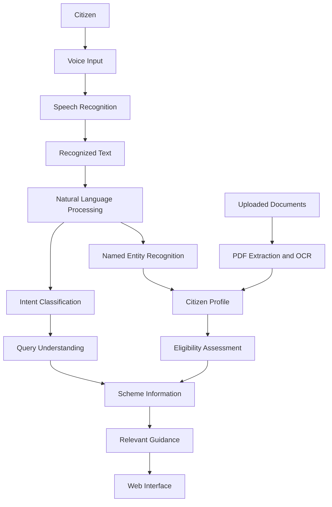

<div align="center">

# VoiceBridge AI

### A Multilingual, Voice-First Assistant for Indian Government Welfare Schemes

An AI-powered platform designed to help citizens discover and understand government welfare schemes through natural voice interaction, multilingual support, profile-based eligibility assessment, and document processing.

<p>
  
  
  
  
</p>

<!-- Add a screenshot of the actual application here. -->


</div>

---

## Overview

Accessing government welfare schemes can be challenging because of language barriers, complex eligibility requirements, and lengthy application procedures. These difficulties can be greater for citizens who are more comfortable speaking their regional language than navigating text-heavy digital platforms.

VoiceBridge AI aims to simplify this process through a voice-first interface that supports English, Hindi, and Marathi. It combines speech recognition, natural language processing, citizen profile management, eligibility assessment, and document extraction to help users explore potentially relevant government schemes.

The goal is to make welfare information more accessible through a simple and understandable digital experience.

## Key Features

### Multilingual Voice Interaction
Supports a voice-first interaction workflow designed for English, Hindi, and Marathi.

### Speech Recognition
Uses a Whisper-based Automatic Speech Recognition (ASR) pipeline to convert spoken input into text.

### Natural Language Processing
Uses Named Entity Recognition (NER) to extract relevant information and intent classification to identify the purpose of user queries.

### Profile-Based Eligibility Assessment
Uses citizen profile information and scheme criteria to help identify potentially relevant government welfare schemes.

### Document Processing
Includes PDF extraction and OCR-related functionality to help extract information from uploaded documents.

### Citizen Profile Management
Supports profile creation and management for collecting information relevant to scheme eligibility.

### Authentication and Data Management
Integrates Supabase authentication and database functionality with backend API routes and middleware.

### Responsive User Interface
Provides a web interface with language selection, dashboards, profile management, document views, and assistant interactions.

## Application Workflow



*This diagram represents the intended workflow. The actual execution path depends on the implemented integrations and configured services.*

## Technology Stack

| Component | Technologies |
|---|---|
| Frontend | React, TypeScript, Vite |
| Styling | Tailwind CSS |
| Backend | Node.js, Express.js |
| Database | Supabase |
| Authentication | Supabase Auth |
| Speech Recognition | Whisper-based ASR |
| NLP | Named Entity Recognition and Intent Classification |
| English NLP Models | CRF-based models, Joblib artifacts |
| Document Processing | PDF extraction and OCR integration |
| Database Migrations | Supabase SQL migrations |
| Testing | Python and JavaScript |

## Project Structure

```text
VoiceBridge_AI-main/
├── ai_service/
│   ├── english/
│   │   ├── english_intent/
│   │   └── english_ner/
│   ├── models/
│   │   ├── hindi_ner/
│   │   ├── marathi_ner/
│   │   └── whisper_small/
│   ├── main.py
│   └── normalizers.py
├── backend/
│   ├── controllers/
│   ├── middleware/
│   ├── models/
│   ├── routes/
│   ├── server.js
│   └── package.json
├── docs/
├── scripts/
├── src/
│   ├── components/
│   ├── context/
│   ├── hooks/
│   ├── i18n/
│   ├── pages/
│   ├── services/
│   └── utils/
├── supabase/
│   └── migrations/
├── package.json
├── .gitignore
└── README.md
```

## Getting Started

### Prerequisites

Install the following before running the application:

- Node.js and npm
- Python compatible with the AI service dependencies
- A Supabase project
- Git

Additional dependencies may be required for speech recognition, model inference, and OCR.

### 1. Clone the Repository

```bash
git clone YOUR_GITHUB_REPOSITORY_URL
cd VoiceBridge_AI-main
```

Replace `YOUR_GITHUB_REPOSITORY_URL` with your repository URL.

### 2. Install Frontend Dependencies

From the project root:

```bash
npm install
```

### 3. Install Backend Dependencies

```bash
cd backend
npm install
cd ..
```

### 4. Configure Environment Variables

Create local environment files using the provided example files, where available.

Configure the variables required by the application, including:

- Supabase project URL
- Supabase public/anonymous key where required
- Backend configuration
- AI service connection settings

Use the exact variable names expected by the source code.

Never commit actual API keys, passwords, service-role keys, or private environment files.

### 5. Configure the AI Service

Install the Python dependencies specified by the project, if a dependency file is available.

Ensure that the required model artifacts are available at the paths expected by the inference code. Some model weights may need to be downloaded separately if they are not included in the repository.

### 6. Configure Supabase

1. Create or select a Supabase project.
2. Configure the required environment variables.
3. Review the SQL migrations in `supabase/migrations/`.
4. Apply the required migrations to your development database.
5. Verify authentication, database permissions, and storage policies.

Review migrations before applying them to a production database.

### 7. Start the Frontend

From the project root:

```bash
npm run dev
```

Open the local URL printed by Vite.

### 8. Start the Backend

Open another terminal:

```bash
cd backend
npm start
```

If `backend/package.json` defines a different script, use the appropriate script from that file.

### 9. Start the AI Service

Start the AI service using the entry point, dependencies, and configuration defined by the project. Verify the expected port, environment variables, and model paths before launching it.

The frontend, backend, and AI service must be configured to communicate correctly for end-to-end functionality.

## Testing

The repository contains test scripts for areas including:

- Age calculation
- AI service logic
- English NLP models
- Local model integration
- PDF extraction
- Regression testing
- Whisper language handling

Example commands:

```bash
python test_ai_service_logic.py
```

```bash
node test_age_calculation.mjs
```

Run tests with their required dependencies installed. Test coverage and results should be verified in the local environment.

## Privacy and Security

VoiceBridge AI may process personal information and uploaded documents. The following precautions are important:

- Do not commit real citizen documents or private uploads.
- Keep credentials and local environment files out of version control.
- Use sanitized sample data for testing and demonstrations.
- Validate uploaded file types and sizes.
- Restrict access to protected API routes and stored documents.
- Avoid logging sensitive profile information or extracted document contents.
- Review Supabase access policies before deployment.
- Verify the licenses of third-party models before redistributing their artifacts.

## Limitations

- Speech recognition may be affected by background noise, accents, and code-switched speech.
- NLP predictions may require validation.
- Eligibility assessments depend on accurate profile information and scheme criteria.
- OCR and PDF extraction may produce errors.
- Some model weights and external services may require separate setup.

Users should verify important eligibility requirements and application instructions through official government sources.

## Future Improvements

- Improve recognition of Hindi, Marathi, English, and mixed-language speech.
- Evaluate ASR using Word Error Rate (WER) and Character Error Rate (CER).
- Improve multilingual entity extraction and intent classification.
- Strengthen document extraction and verification.
- Expand eligibility assessment and scheme recommendation coverage.
- Improve local inference and offline deployment.
- Add comprehensive integration and end-to-end tests.

## Contributing

Contributions and suggestions are welcome.

1. Fork the repository.
2. Create a feature branch.
3. Make focused changes.
4. Run the relevant tests.
5. Submit a pull request describing your changes.

Do not include credentials, personal data, or private documents in contributions.

## License

Add an appropriate `LICENSE` file before publicly distributing the project. Also review the licenses of third-party models and dependencies.

---

<div align="center">

**VoiceBridge AI**

Making government welfare information more accessible through multilingual voice interaction.

</div>
